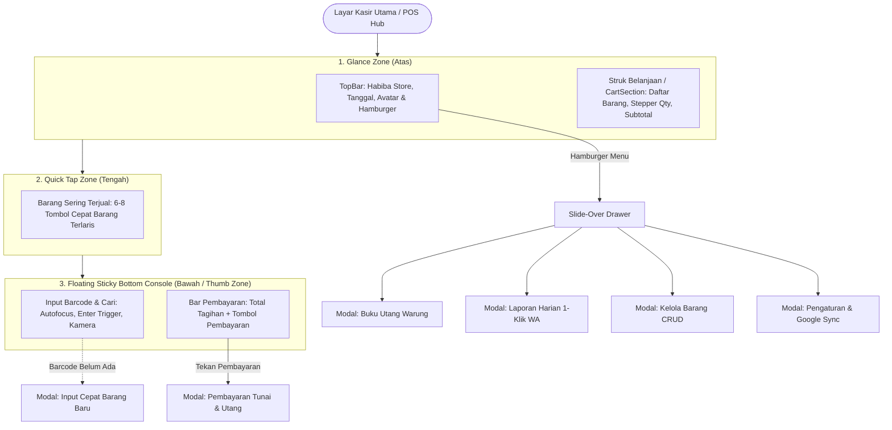

# Product Requirements Document (PRD) & Blueprint Arsitektur: Kasiry (Habiba Store)

**Versi Dokumen:** 2.2 (Final Prototype Sign-Off, Ergonomi Terbalik, & Desain Glassmorphism Modern)  
**Status:** Approved for Implementation  
**Penulis:** Yodi & Antigravity (AI Assistant)  
**Identitas Toko:** Habiba Store (Pemilik: Habiba | WA: 081234567890)  
**Platform Target:** Progressive Web App (PWA) Mobile-First & Desktop POS  
**Repository GitHub:** `https://github.com/yodi-dev/kasiry.git`  
**Workspace:** `d:\web\kasiryy`  

---

## 📌 Dokumen Kontrol & Riwayat Versi (Changelog)

| Versi | Tanggal | Penulis | Ringkasan Perubahan Utama |
| :---: | :---: | :---: | :--- |
| **v2.2** | 22 November 2026 | Yodi & AI Assistant | **Penyelarasan Ergonomi Inverted & Identitas Toko Habiba Store:**<br>1. **Identitas Toko Resmi:** Diselaraskan menjadi **Habiba Store** (Owner: Habiba).<br>2. **Ergonomi Tata Letak Terbalik (*Inverted Ergonomic Flow*):**<br>&nbsp;&nbsp;&nbsp;• **Glance Zone (Atas):** *Struk Belanjaan (Cart)* ditempatkan di paling atas layar agar kasir leluasa membaca barang tanpa tertutup tangan/jempol.<br>&nbsp;&nbsp;&nbsp;• **Quick Tap Zone (Tengah):** *Barang Sering Terjual* (6–8 barang terlaris warung, tanpa ikon berlebihan, harga lugas).<br>&nbsp;&nbsp;&nbsp;• **Floating Sticky Bottom Console (Bawah / Thumb Zone):** Konsol melayang di jangkauan jempol bawah terdiri dari dua lapis:<br>&nbsp;&nbsp;&nbsp;&nbsp;&nbsp;- Lapis Atas: Form Input Barcode & Pencarian Barang (dengan **Autofocus tangguh**, *ring glow*, dan pop-up hasil pencarian mengambang ke **atas** / `bottom-full`).<br>&nbsp;&nbsp;&nbsp;&nbsp;&nbsp;- Lapis Bawah: Bar Total Tagihan & tombol **"Pembayaran"**, bersifat kondisional (hanya muncul saat ada barang di keranjang).<br>3. **Desain Visual Glassmorphism Modern:** Mengadopsi palet ethereal soft light-blue (`#e2effb` ke `#edf5fd`), kartu frosted glass putih (`bg-white/90 rounded-3xl`), dan tombol Deep Midnight Navy (`#0a193d`) dengan aksen Azure Sky Blue (`#0284c7`).<br>4. **Pembersihan Anti-Slop & Anti-Jargon:** Menghapus seluruh teks teknis dan jargon akuntansi rumit (*COGS, Gross Profit, Accordion slop*). Menggunakan bahasa pasar murni (*Uang Masuk, Perkiraan Untung, Buku Utang, Pembayaran*). |
| **v2.1** | 22 November 2026 | Yodi & AI Assistant | Evolusi ke Progressive Web App (PWA) & Ekosistem Google ($0 Cost): Vue 3, Tailwind CSS v4, Dexie.js IndexedDB, Google Sheets & GIS auth, dan ekspor Excel offline. |
| **v2.0** | 22 November 2026 | Yodi | Konsolidasi konsep awal, branding warung kelontong, dan model bisnis beli-putus. |

---

## 1. Ringkasan Eksekutif & Identitas Brand

### 1.1 Filosofi Produk
**Kasiry** adalah aplikasi kasir (*Point of Sale*) Progressive Web App (PWA) yang dirancang khusus untuk **warung kelontong dan pedagang UMKM mikro di Indonesia**.

**Prinsip Inti:**
1. **Nol Hambatan Login (*Zero Login Wall*):** Buka aplikasi web langsung masuk ke mode kasir siap melayani transaksi pembeli.
2. **100% Berfungsi Tanpa Internet (*Offline-First*):** Seluruh data transaksi, struk, dan pencatatan utang tersimpan di IndexedDB browser lokal (Dexie.js).
3. **Ergonomi Jempol Ekstrem:** Area input dan tombol aksi utama berada di separuh bawah layar yang mudah dijangkau satu tangan (*Thumb Zone*), sementara area pembacaan struk berada di separuh atas (*Glance Zone*).
4. **Cloud Backup Gratis ($0 Server Cost):** Menggunakan Google Sheets dan Google Drive milik pengguna via Google Identity Services (GIS).

### 1.2 Identitas Merek (Brand Identity)
* **Nama Produk:** **Kasiry**
* **Toko Acuan / Prototipe:** **Habiba Store**
* **Tagline:** *"Kasiry: Aplikasi Kasir Warung Paling Gampang."*
* **Palet Warna Utama (Modern Ethereal Glassmorphism):**
  * **Midnight Deep Navy (`#0a193d`):** Warna utama teks, tombol primer, dan kartu checkout, memberikan kesan profesional, kokoh, dan berwibawa.
  * **Azure / Sky Blue (`#0284c7` / `#38bdf8`):** Warna aksen interaktif, tombol aksi checkout, dan indikator aktif/fokus.
  * **Ambient Radial Background (`#e2effb` ke `#edf5fd`):** Latar belakang gradien biru lembut yang menyejukkan mata kasir seharian dan bebas silau.
  * **Frosted Glass Surface (`rgba(255, 255, 255, 0.9)`):** Kartu putih tembus pandang dengan efek blur (`backdrop-blur-md`) dan sudut membulat lebar (`rounded-3xl`).
  * **Alert / Utang (`#ef4444`):** Penanda tegas buku utang dan penghapusan data.

---

## 2. Target Pengguna (User Persona)

### Persona 1: Ibu Habiba (48 Tahun) - Pemilik Warung Kelontong
* **Karakter:** Mengelola warung kelontong dari pagi hingga malam. Menggunakan smartphone Android kelas menengah.
* **Kebiasaan:** Menggunakan WhatsApp dan kalkulator fisik. Sering lupa menagih utang pelanggan karena buku kertas sering terselip.
* **Kebutuhan:** Tampilan yang bersih, mudah dibaca tanpa kacamata tebal, pencatatan utang instan, dan laporan harian yang bisa dikirim ke WhatsApp dalam 1 kali ketuk.

### Persona 2: Penjaga Toko Pengganti / Anak Pemilik
* **Karakter:** Sering menjaga toko bergantian saat pemilik pergi belanja ke agen grosir.
* **Kebiasaan:** Menggunakan barcode scanner fisik atau kamera HP untuk barang berkemasan, dan tombol cepat untuk barang curah (Gas LPG, Telur, Minyak).
* **Kebutuhan:** Barcode scanner langsung terbaca otomatis (*autofocus*), tidak perlu memilih-milih menu yang rumit.

---

## 3. Arsitektur Informasi & Tata Letak Layar Tunggal (POS Hub)

Aplikasi Kasiry beroperasi dengan prinsip **"Single-Screen POS Hub"**: seluruh aktivitas transaksi jual-beli diselesaikan di layar utama tanpa berpindah-pindah URL.



### Rincian Zona Tampilan Utama:
1. **TopBar:**
   - Ikon Hamburger 2-garis minimalis di kiri (membuka Navigation Drawer).
   - Nama Toko: **Habiba Store** & Tanggal hari ini di tengah.
   - Avatar Profil Toko + Dot status online hijau di kanan.
2. **Struk Belanjaan (CartSection - Atas):**
   - Menampilkan jumlah jenis barang dan total pcs.
   - Daftar item belanjaan dengan nama, harga satuan, tombol kuantitas `[-] [qty] [+]`, dan subtotal.
   - Tombol "Kosongkan" saat ingin membatalkan seluruh transaksi.
   - Ketinggian maksimal dibatasi (`max-h-[35vh]`) dengan scroll internal agar tetap proporsional.
3. **Barang Sering Terjual (FrequentProductsSection - Tengah):**
   - Menampilkan 6 hingga 8 kartu barang terlaris warung (Gas LPG 3kg, Galon Aqua, Telur 1kg, Indomie, Minyak Goreng, Beras).
   - Bersih tanpa kategori rumit dan tanpa ikon dekoratif yang berlebihan.
4. **Floating Sticky Bottom Console (Konsol Melayang di Bawah):**
   - **Form Input Barcode & Pencarian:** Melayang di atas bar tagihan. Memiliki autofocus aktif saat halaman dibuka, halo ring fokus biru, dan dropdown hasil pencarian yang mengambang ke arah **atas** (`bottom-full mb-2.5`).
   - **Bar Total Tagihan & Pembayaran:** Kapsul Deep Navy berisi total tagihan nominal rupiah dan tombol **"Pembayaran"**. Hanya muncul saat ada barang di keranjang (`itemCount > 0`).

---

## 4. Spesifikasi Fungsional Fitur Utama

### 4.1 Barcode Scanner Hardware (HID) & Autofocus
* **Autofocus Berlapis:** Input pencarian memiliki `autofocus` HTML5, `nextTick()` focus pada `onMounted`, serta pemulihan fokus otomatis saat jendela peramban kembali aktif (`window.focus`).
* **Global Typing Capture:** Mengetik tombol alfanumerik di mana saja pada layar kasir otomatis mengalihkan fokus ke input barcode tanpa menghapus karakter pertama.
* **Deteksi Enter Scanner:** Tembakan barcode scanner fisik mengirim sinyal `Enter`. Sistem otomatis memeriksa kecocokan barang:
  * Jika barang ditemukan $\rightarrow$ langsung masuk ke keranjang belanjaan!
  * Jika barang belum ada $\rightarrow$ membuka *Lazy Inventory Modal* untuk mendaftarkan barang baru dalam hitungan detik.

### 4.2 Lazy Inventory (Input Kilat Barang Baru)
* Kasir tidak perlu meninggalkan layar transaksi jika ada produk baru yang discan.
* Pop-up meminta: Nama Barang, Harga Jual, dan Harga Modal (otomatis disarankan 80% dari harga jual).
* Sekali klik simpan, barang tersimpan ke IndexedDB dan langsung masuk ke keranjang belanjaan saat itu juga.

### 4.3 Pembayaran Cerdas: Tunai vs Bon/Utang
* **Mode Tunai:**
  * Tombol Uang Pas.
  * Saran pembulatan ke atas (misal total Rp 24.500 disarankan Rp 25.000, Rp 30.000, Rp 50.000).
  * Pecahan rupiah standar (Rp 2.000, Rp 5.000, Rp 10.000, Rp 20.000, Rp 50.000, Rp 100.000).
  * Tampilan uang kembalian besar dan jelas.
* **Mode Utang / Bon:**
  * Pencarian cepat nama tetangga/pelanggan.
  * Jika pelanggan baru, cukup ketik nama langsung tersimpan tanpa formulir bertele-tele.
  * Masuk otomatis ke Buku Utang Digital.

### 4.4 Buku Utang Digital & Tagih WhatsApp
* Mencatat saldo utang per pelanggan dan tanggal transaksi terakhir.
* Tombol catat cicilan / pelunasan utang.
* Tombol **"Kirim WA Pengingat"**: membuka tautan WhatsApp dengan pesan sopan dan ramah yang dirancang khusus untuk budaya desa.

### 4.5 Laporan Harian Warung (1-Klik WA & Excel)
* Rekap Uang Masuk, Perkiraan Untung Bersih, Jumlah Transaksi, dan Bon/Utang Baru.
* Daftar barang paling laris hari ini.
* Tombol **"Kirim ke WhatsApp"**: menghasilkan teks rekap rapi dan membuka WhatsApp pemilik warung.
* Tombol **"Unduh Excel"**: mengekspor laporan pembukuan lengkap dalam format `.xlsx` secara offline.

### 4.6 Sinkronisasi Cloud $0 (Google Sheets & Drive)
* Menghubungkan Google Spreadsheet pemilik toko tanpa memerlukan server berbayar.
* Data transaksi, barang terjual, dan saldo utang tersimpan rapi di Google Sheets sehingga pemilik dapat memantau warung dari mana saja.

---

## 5. Model Data Lokal (Dexie.js IndexedDB)

```javascript
// Database Schema: KasiryDatabase (v1)
db.version(1).stores({
  products: '++id, barcode, name, category, sellPrice, buyPrice, isMacro, createdAt',
  transactions: '++id, invoiceNumber, createdAt, totalAmount, paymentMethod, customerId, status',
  transactionItems: '++id, transactionId, productId, name, sellPrice, buyPrice, qty, subtotal',
  customers: '++id, name, phone, totalDebt, updatedAt',
  debtPayments: '++id, customerId, amount, paymentDate, notes',
  settings: 'key, value'
})
```

---

## 6. Standar Kualitas & Non-Fungsional (NFR)

1. **Kecepatan Build & Render:** Waktu kompilasi Vite $< 1.5$ detik, ukuran bundle gzip $< 60$ KB.
2. **Respon Sentuh:** Responsivitas tap $< 50$ ms tanpa lag.
3. **PWA Standar:** Lolos audit PWA Lighthouse (Service Worker Workbox, Offline Cache, App Manifest, Icon 192px/512px).
4. **Keamanan Data:** Data tersimpan lokal di IndexedDB dengan `navigator.storage.persist()` untuk mencegah penghapusan otomatis oleh peramban saat memori HP menipis.
