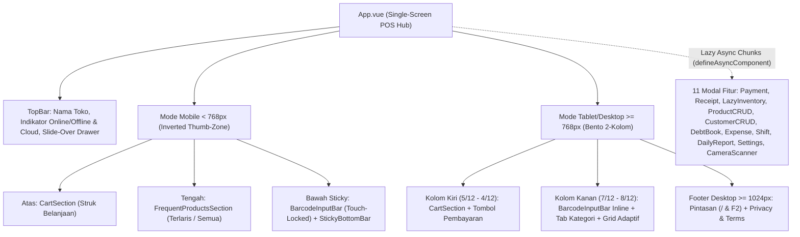

# Product Requirements Document (PRD) & Blueprint Arsitektur: Kasiry POS

**Versi Dokumen:** 2.15 (QRIS, Pengeluaran Harian, Shift, Multi Harga, Kulakan Stok Lunak, 300 Katalog Bersih & Printer Thermal Bluetooth/USB/Serial)  
**Status:** Production-Ready & Terverifikasi Build/Unit-Integration Test  
**Penulis:** Yodi & Antigravity (AI Assistant)  
**Identitas Toko Bawaan:** Warung Kasiry (Generik siap pakai — profil disesuaikan pemilik warung di Pengaturan)  
**Platform Target:** Progressive Web App (PWA) Mobile-First, Tablet & Desktop POS  
**Repository GitHub:** `https://github.com/yodi-dev/kasiry.git`  
**Workspace:** `d:\web\kasiryy`  

---

## Dokumen Kontrol & Riwayat Versi (Changelog Ringkas)

> Riwayat perubahan detail tiap rilis tercatat di [`CHANGELOG.md`](CHANGELOG.md).

| Versi | Tanggal | Ringkasan Milestone |
| :---: | :---: | :--- |
| **v2.15.1–v2.15.2** | 27 November 2026 | **Branding `Kasiry by Awanbeo`, Tautan Portofolio & PWA Auto-Reload:** Penyeragaman footer **`Kasiry by Awanbeo`** + tautan `https://awanbeo.my.id` di struk fisik/HTML/preview, WhatsApp nota/laporan/shift, footer desktop, & SEO `index.html`, serta reload otomatis saat Service Worker memperbarui cache lama (`src/main.js`). |
| **v2.15.0** | 27 November 2026 | **Dukungan Printer USB/OTG (`WebUSB`), Port Serial (`Web Serial`) & Cetak Browser Iframe Terisolasi:** Ekspansi `useThermalPrinter.js` & `thermalPrinter.js` dengan `WebUSB` + `Web Serial` (auto-reconnect di `App.vue`, panduan Android OTG vs Windows `WinUSB`/`POS-58`), cetak HTML `iframe` terisolasi `58mm`/`80mm` bebas backdrop modal, serta tombol **`BT`** / **`USB`** / **`Serial`** di `SettingsModal` & `ReceiptModal`. |
| **v2.14.0** | 27 November 2026 | **Roadmap #7 (Printer Thermal Bluetooth ESC/POS) + Hotfix Harga Keranjang:** Encoder ESC/POS murni (`thermalPrinter.js`), composable Web Bluetooth (`useThermalPrinter.js`) dg fallback `window.print()`, tab **`Printer`** di `SettingsModal.vue` (`58mm`/`80mm`, *auto-print*, catatan bawah struk, *Tes Cetak*), pembaruan `ReceiptModal.vue` (hide `WA:` kosong, `.thermal-80mm`, `Cetak BT`), serta perbaikan penguncian tier saat simpan Grosir/Agen di mode nota `Ecer`. |
| **v2.13.1** | 27 November 2026 | **Hotfix Live Sync Multi-Harga Keranjang:** Memastikan perubahan harga Ecer/Grosir/Agen langsung berlaku real-time saat ganti `Harga Nota` tanpa perlu mengosongkan keranjang (`repriceCartItems` + guard `Ecer (Kosong)`). |
| **v2.13.0** | 27 November 2026 | **Roadmap #6 (Pembersihan Seed Awal, 300 Katalog Warung & Kebersihan Barang Pasif):** Ekspansi ke 300 barang populer warung harga `Rp 0` (`barcode: ''`, *dynamic import* `seedData.js`), pembersihan pelanggan awal menjadi `'Umum'` saja (`0` utang) & profil generik `Warung Kasiry`, fitur filter `Belum Harga`, `Belum Terjual`, & `Sepi ≥30 Hr` + isi harga cepat & hapus massal di `ProductManagementModal`, auto-edit harga barang `Rp 0` di `CartSection`, dan tombol reset `Mulai Toko Kosong` di `SettingsModal`. |
| **v2.12.0** | 27 November 2026 | **Roadmap #5 (Fitur Kulakan / Belanja Stok & Stok Lunak):** Modal `RestockModal.vue` (`Catat Kulakan` multi-item + 3 sumber dana `Tunai Laci`, `QRIS / Rek`, `Dana Luar` + tab `Riwayat Kulakan` dg hapus rollback), skema Dexie `v5` `restocks`, manajemen stok lunak (`stock: null` tak terlacak vs angka non-blocking sehingga stok `0` tetap bebas dibeli), Excel 7 sheet (`Riwayat Kulakan`), Google Sheets `KULAKAN` & merge Drive. |
| **v2.11.0** | 27 November 2026 | **Roadmap #4 (Multi Harga Ecer / Grosir / Agen & Edit Manual):** Mesin harga `src/utils/pricing.js` (`Ecer` default + opsional `Grosir`, `Min. Qty`, `Agen` dengan fallback aman), saklar tier nota & editor harga manual inline di `CartSection.vue` (plus opsi simpan ke katalog), level harga default di `CustomerManagementModal.vue` yang otomatis sinkron di `PaymentModal.vue`, serta badge harga tier di `ReceiptModal.vue`. |
| **v2.10.0** | 27 November 2026 | **Roadmap #3 (Sistem Buka & Tutup Shift / Tutup Buku Harian):** Modal `ShiftModal.vue` (prompt pagi + tombol *"Nanti Saja"*, auto-modal awal terakhir, pengadopsian catatan hari ini, tutup buku fisik laci vs `expectedCash` + live selisih, kirim WA tutup shift), chip status shift di `TopBar.vue`, skema Dexie `v4` `shifts` + tag `shiftId/shiftCode`, tab **Shift** di `DailyReportModal`, Excel 6 sheet (`Riwayat Shift`), dan Google Sheets `BUKA/TUTUP SHIFT` + merge Drive. |
| **v2.9.0–v2.9.1** | 27 November 2026 | **Roadmap #2 (Pengeluaran Harian & Navigasi Kompak + Hotfix UI):** Modal `ExpenseModal.vue`, tabel Dexie `v3` `expenses`, isolasi `prive` dari laba, Excel 5 sheet (`Pengeluaran Kas`), Google Sheets `KAS KELUAR`, TopBar kompak (`Stok & Data ▾`, `Buku Utang`, `Kas Keluar`, `Laporan`, `⚙️`), serta fix stacking context `z-40` dropdown & badge kuantitas `top-1.5 right-1.5`. |
| **v2.8.1–v2.8.3** | 26 November 2026 | **Stabilisasi QRIS & Cetak Termal:** Hotfix `getCustomerTxCount` & suite komponen `@vue/test-utils`, tata letak KPI kembalian desktop `PaymentModal`, isolasi `@media print` di `ReceiptModal`, serta fix clipping kartu KPI QRIS (`min-w-0`). |
| **v2.8.0** | 26 November 2026 | **Roadmap #1 (Metode Bayar QRIS & Pemisahan Laci):** Tab `QRIS` di `PaymentModal.vue` (otomatis uang pas, prefix `QRS-`), opsi `Tunai | QRIS` di pelunasan Buku Utang, pemisahan Laci Tunai vs QRIS di Laporan Harian, WA, Excel & Google Sheets (`computeDailyStats`). |
| **v2.7.1** | 26 November 2026 | **Tahap 3 (Sinkronisasi Dokumen & Checklist Rilis):** Pembaruan menyeluruh `README.md`, `PRD_v2.0.md`, `SITEMAP.md`, serta checklist final verifikasi Google OAuth & uji perangkat fisik. |
| **v2.7.0** | 26 November 2026 | **Tahap 2 (Automated Testing & Bersih-Bersih Kode):** Setup Vitest + `fake-indexeddb` (5 suite, 12 skenario test), perbaikan bug `DAY_MS` pada modul arsip, penghapusan sisa `licenseStatus`, 6 file prototipe mati, serta migrasi skema Dexie `v1 -> v2` (`transactionItems: null`). |
| **v2.6.0** | 26 November 2026 | **Tahap 1 (Pemecahan Bundle / Code Splitting):** Pemisahan chunk `vendor-vue`, `vendor-dexie`, `vendor-xlsx`, `vendor-zxing`, dynamic `import('xlsx')`, `defineAsyncComponent` untuk seluruh 9 modal sekunder + idle pre-warm jalur checkout, serta `{ immediate: true }` pada watcher open modal. |
| **v2.5.0** | 26 November 2026 | **Bento UI, Hybrid Scanner & Skalabilitas Multi-Tahun:** Layout Bento 2-kolom untuk Tablet/Desktop, kunci soft-keyboard HP hingga disentuh, hybrid `BarcodeDetector` + `@zxing/library` + kamera depan, tambah kategori inline di Lazy Inventory, jendela RAM 90 hari, `buildCustomerStatsMap` $O(N)$, batching Drive, & **Arsip Data Tahunan**. |
| **v2.4.2** | 25 November 2026 | **QA Browser & Stabilisasi:** Modal Manajemen Pelanggan, pelanggan default `"Umum"`, helper `toPlain()` pencegah `DataCloneError`, validasi kembalian cicilan bon pecahan besar. |
| **v2.4.0** | 23 November 2026 | **Cloud Sync Google $0:** GIS login 1-klik, snapshot Google Drive (`kasiry-backup.json`), Buku Kas Google Sheets, dan two-way sync dengan antrean offline. |
| **v2.3.0** | 23 November 2026 | **Tahap 1–3 Core:** Dexie.js IndexedDB (`KasiryDB`), scanner USB/BT + audio beep, struk 58mm & WA, Buku Utang Digital, Laporan Harian & ekspor Excel multi-sheet. |
| **v2.2.0** | 22 November 2026 | **Ergonomi Terbalik & Glassmorphism Modern:** *Inverted Ergonomic Flow*, identitas Habiba Store, dan palet Midnight Deep Navy `#0a193d` + Azure Sky `#0284c7`. |

---

## 1. Ringkasan Eksekutif & Identitas Brand

### 1.1 Filosofi Produk
**Kasiry** adalah aplikasi kasir (*Point of Sale*) Progressive Web App (PWA) *offline-first* yang dirancang khusus untuk **warung kelontong dan UMKM mikro Indonesia**.

**Prinsip Inti:**
1. **Nol Hambatan Login (*Zero Login Wall*):** Buka aplikasi langsung masuk ke layar Kasa siap bertransaksi.
2. **100% Berfungsi Tanpa Internet (*Offline-First*):** Seluruh katalog, transaksi, dan piutang tersimpan di IndexedDB (`Dexie.js`) dan aset/chunk JS di-precache oleh Service Worker Workbox.
3. **Ergonomi Adaptif per Perangkat:** Mobile memakai ergonomi jangkauan jempol di bawah (*Thumb Zone*) tanpa footer pengganggu; Tablet & Desktop memakai stasiun kerja *Bento 2-Kolom* lengkap dengan filter kategori & pintasan keyboard.
4. **Cloud Backup Gratis ($0 Server Cost):** Menggunakan Google Sheets & Google Drive milik pemilik warung via Google Identity Services (GIS).
5. **Ringan Lintas Tahun:** Arsitektur memori berjendela (*90-day RAM window*) + alat arsip tahunan memastikan aplikasi tetap cepat meski riwayat transaksi menumpuk puluhan ribu baris.

---

## 2. Target Pengguna (User Persona)

- **Persona 1 — Ibu Habiba (Pemilik Warung):** Mengoperasikan kasir harian dari ponsel Android kelas menengah, butuh tampilan kontras tinggi yang mudah dibaca, Buku Utang digital berurutan rapi + pengingat WhatsApp sopan, dan laporan harian dalam 1 ketukan.
- **Persona 2 — Penjaga Toko Pengganti / Kasir Desktop:** Menggunakan barcode scanner USB/Bluetooth atau kamera HP (depan/belakang) untuk barang kemasan, serta tombol cepat terkurasi & kategori untuk barang curah (Gas LPG, Galon, Telur, Beras).

---

## 3. Arsitektur Antarmuka & Tata Letak Adaptif (`App.vue`)

Aplikasi beroperasi sebagai **Single-Screen POS Hub** dengan dua mode layout adaptif:



---

## 4. Spesifikasi Fungsional Implementasi Aktual

### 4.1 Barcode Scanner Hardware (HID), Kamera Hybrid & Keyboard Lock
- **Desktop Non-Sentuh (`isDesktopAutoFocus`):** Mendukung *autofocus* penuh, tombol pintas `/` untuk cari & `F2` untuk langsung membuka Pembayaran, serta global key capture ke input pencarian.
- **Perangkat Sentuh / Mobile:** Input kasa menerapkan kunci soft-keyboard (`inputMode="none"` hingga input disentuh langsung) agar keyboard virtual Android/iOS tidak otomatis menyembul setelah ketuk barang cepat atau menutup sidebar/modal.
- **Scanner Kamera Hybrid (`CameraScannerModal.vue`):** Menggabungkan `BarcodeDetector` native dengan fallback `@zxing/library` (`MultiFormatReader` `TRY_HARDER`), switch kamera depan/belakang (flip horizontal + panduan jarak), zoom hardware/digital, lampu flash (*torch*), dan sinyal beep audio.

### 4.2 Lazy Inventory & Kategori Dinamis
- Pemindaian atau pencarian barcode yang belum terdaftar membuka `LazyInventoryModal.vue` dengan barcode terisi otomatis.
- Kasir dapat memilih kategori atau membuat **kategori baru secara inline** tanpa keluar modal, mengisi harga jual & estimasi modal (default 80%), lalu barang langsung masuk katalog IndexedDB sekaligus keranjang belanja.

### 4.3 Pembayaran Tunai, Utang/Bon & Manajemen Pelanggan
- **Tunai:** Pelanggan default **"Umum"** (dapat diganti via dropdown pencarian yang otomatis diurutkan berdasarkan frekuensi belanja $O(N)$ lewat `buildCustomerStatsMap`), nominal uang pas, saran pembulatan, dan pecahan rupiah standar.
- **Utang / Bon:** Akun `"Umum"` otomatis diblokir baik di UI (`PaymentModal.vue`) maupun di lapisan database (`useKasiryDB.js`) agar utang selalu terikat ke pelanggan nyata. Pencarian nama atau daftar pelanggan baru berlangsung instan tanpa formulir panjang.
- **Manajemen Pelanggan (`CustomerManagementModal.vue`) & Buku Utang (`DebtBookModal.vue`):** Dilengkapi riwayat belanja penuh per pelanggan lewat query indeks on-demand (`getCustomerTransactions`), cicilan utang dengan pembatasan nominal lunas vs uang kembalian (`Math.min(amount, currentDebt)`), serta tombol pengingat WhatsApp sopan.

### 4.4 Laporan Shift/Harian, Buka-Tutup Shift, Kas Keluar, Excel 6-Sheet & Arsip Data Tahunan
- **Buka & Tutup Shift (`ShiftModal.vue`):** Mengelompokkan operasional 1 hari buka warung dalam 1 sesi shift fleksibel (mendukung tutup lewat tengah malam), auto-isi modal awal & pengingat shift kemarin yang lupa ditutup, serta rekonsiliasi fisik laci (`Modal Awal + Tunai Masuk - Kas Keluar Laci`) lengkap dengan pesan tutup buku WhatsApp.
- **Catatan Kas Keluar (`ExpenseModal.vue`):** Mencatat pengeluaran kas harian dengan preset kategori (`Operasional`, `Makan & Transport`, `Tarik / Setor Owner`, `Lainnya`), sumber dana `Tunai (Dari Laci)` vs `Non-Tunai (QRIS / Rek)`, KPI real-time Sisa Tunai Laci, dan isolasi kategori `prive` agar tarik kas owner tidak mengurangi estimasi untung jualan.
- **Laporan Kasir (`DailyReportModal.vue`):** Otomatis memakai lingkup **Shift Aktif** (atau hari kalender jika belum buka shift), menampilkan Uang Masuk Kas (Tunai & QRIS), Total Kas Keluar + Sisa Laci Bersih, Perkiraan Untung Bersih, Bon Baru, Top 5 Barang Terlaris, tab Kas Keluar, tab Riwayat Transaksi, tab Riwayat Shift tutup buku, kirim rekap WhatsApp, serta ekspor **Excel 7 sheet** (`Ringkasan Kas`, `Daftar Transaksi`, `Barang Terjual`, `Buku Utang Pelanggan`, `Pengeluaran Kas`, `Riwayat Shift`, `Riwayat Kulakan`) via dynamic `import('xlsx')`.
- **Skalabilitas & Arsip Data Tahunan (`SettingsModal.vue`):**
  - Memori runtime (`useKasiryDB.js`) memakai `shallowRef([])`, hanya memuat **90 hari terakhir** ke UI Kasa harian (`ACTIVE_HISTORY_DAYS = 90`), serta melakukan pembaruan state parsial setelah checkout & CRUD.
  - Fitur **Kesehatan & Arsip Data Tahunan** menyediakan pilihan retensi `> 3 Bulan`, `> 6 Bulan`, dan `> 1 Tahun` yang otomatis mengunduh file `Arsip_<NamaToko>_sd_<Tanggal>.json` (+ mengunggah salinan arsip ke Google Drive bila terhubung & online), menyimpan `archiveState.cutoffAt`, lalu membersihkan baris lama di IndexedDB tanpa mengubah produk maupun `totalDebt` pelanggan.
- **Koneksi Printer Thermal Bluetooth & Fallback Browser (`useThermalPrinter.js`, `thermalPrinter.js`, `ReceiptModal.vue`, `SettingsModal.vue`):**
  - Mendukung koneksi langsung **Web Bluetooth GATT (ESC/POS)** tanpa dependensi pihak ketiga dengan chunking BLE aman (80 byte -> retry 20 byte) untuk kertas **`58mm` (32 kolom)** dan **`80mm` (48 kolom)**, pengaturan **`autoPrint`** pasca-bayar, catatan bawah struk kustom, **`Tes Cetak Printer`**, penyembunyian baris `WA:` kosong, serta fallback otomatis ke `window.print()`.

### 4.5 Cloud Sync `$0` (Google Drive, Google Sheets & Kepatuhan OAuth)
- Koneksi Google 1-klik via Google Identity Services (`useGoogleSync.js`), mendukung offline queue untuk Google Sheets (`flushPendingSheetQueue`), merge two-way LWW berbasis `updatedAt`, penghormatan `archiveState` antar-perangkat (sementara impor JSON manual tetap dapat memulihkan file arsip lama via `honorArchiveCutoff: false`), dan *adaptive Drive batching* (10 transaksi / 3 menit saat transaksi $\ge 200$).
- Mendukung penayangan di Cloudflare Pages dengan `/privacy.html`, `/terms.html`, `_headers` COOP (`same-origin-allow-popups`), serta bypass SW fallback di `vite.config.js`.

---

## 5. Model Data Lokal (Dexie.js `KasiryDB` v5)

```javascript
// src/db/index.js — KasiryDatabase
db.version(1).stores({
  products: '++id, barcode, name, category, isMacro, updatedAt, deleted',
  transactions: '++id, invoiceNumber, createdAt, paymentMethod, customerId, updatedAt',
  transactionItems: '++id, transactionId, productId, updatedAt',
  customers: '++id, name, phone, totalDebt, updatedAt, deleted',
  debtPayments: '++id, customerId, paymentDate, updatedAt',
  settings: 'key, updatedAt'
})

// Migrasi bersih ke v2: item belanja disimpan inline pada transactions.items
db.version(2).stores({
  transactionItems: null
})

// Migrasi v3: pencatatan pengeluaran kas keluar harian
db.version(3).stores({
  expenses: '++id, expenseNumber, createdAt, category, source, updatedAt, deleted'
})

// Migrasi v4: pencatatan buka & tutup shift harian
db.version(4).stores({
  shifts: '++id, shiftCode, status, openedAt, closedAt, updatedAt, deleted'
})

// Migrasi v5: pencatatan kulakan / belanja stok masuk
db.version(5).stores({
  restocks: '++id, restockNumber, createdAt, source, supplierName, updatedAt, deleted'
})
```
*Catatan `settings` keys:* `storeProfile`, `categories`, `archiveState` (`{ cutoffAt }`), `lastOpeningCash`. Format backup JSON eksternal mempertahankan `version: '2.4'` (kompatibel lintas versi dengan node opsional `expenses`, `restocks`, & `shifts`).

---

## 6. Standar Kualitas, Arsitektur Build & Automated Testing

1. **Code Splitting & Bundle Budget:**
   - Konfigurasi Rolldown `codeSplitting.groups` di `vite.config.js` memisahkan `vendor-vue`, `vendor-dexie`, `vendor-xlsx`, dan `vendor-zxing`.
   - Entry bundle `index` terjaga ringan (< target 60 KB gzip per chunk utama), bebas chunk warning `> 500 kB`, dengan 12 modal sekunder terpisah sebagai async chunks (`prewarmCheckoutChunks` menghangatkan `PaymentModal`, `LazyInventoryModal`, dan `ReceiptModal` saat browser luang).
2. **Offline PWA Precaching:** Workbox men-generate service worker precache di `dist/sw.js` sehingga seluruh chunk pecahan & aset statis tetap berjalan offline 100%.
3. **Automated Tests:** Dijalankan melalui `npm test` (`Vitest` + `fake-indexeddb` + `@vue/test-utils`/`happy-dom`) mencakup 10 suite & 42 skenario di folder `tests/` (`customerStats`, `dailyStats`, `pricing`, `productUsage`, `thermalPrinter`, `useKasiryDB`, `useGoogleSync`, `dbMigration` `v1 -> v5`, `excelExport`, dan `uiModals`).
4. **Penyimpanan Persisten & Render Katalog:** `navigator.storage.persist()` aktif saat inisialisasi DB, dan kartu katalog di bawah lipatan layar (`idx >= 16`) memakai `.offscreen-card-defer` (`content-visibility: auto; contain-intrinsic-size: auto none auto 92px;`).

---

## 7. Checklist Rilis Produksi & Uji Perangkat Fisik

Status terbaru sebelum rilis penuh ke pemilik warung:
- [x] Build produksi bersih (`npm run build`), 0 error & 0 warning ukuran chunk.
- [x] Automated tests Vitest lulus (`npm test`: 10 suite, 42 skenario).
- [x] Verifikasi domain Google Search Console aktif (`public/google50a425d7a5de8ecd.html`).
- [x] Halaman `/privacy.html`, `/terms.html`, ikon OAuth (`kasiry-oauth-120x120.png`), serta COOP header tersedia di `public/`.
- [x] Test cetak printer thermal kabel USB langsung (`WebUSB` + `WinUSB`) terkonfirmasi berhasil oleh pemilik produk.
- [ ] **Uji Fungsional & UI Per Modul (Tahap Aktif Sekarang):**
  - Verifikasi browser E2E per modul (Modul 1–10: Kasa/Katalog, Pembayaran, Struk/Printer, Shift, Kas Keluar, Kulakan, Buku Utang/Pelanggan, Kelola Barang Pasif, Laporan/Excel, & Pengaturan/Cloud Sync) sekaligus kumpulkan list revisi UI.
  - Test hardware barcode scanner USB OTG / Bluetooth, kamera belakang/depan HP, USB OTG Android & Bluetooth BLE printer pada perangkat fisik tambahan.
  - Test mode restore **Timpa Total (Reset)**, **Arsip Tahunan + Drive**, dan reload offline PWA (`npm run preview` / `https://kasiry.pages.dev`).
  - Pastikan status **Google OAuth Consent Screen** di Google Cloud Console berstatus *Published / Verified* agar akun Google toko baru tidak terkena batasan *Testing mode*.

---

## 8. Roadmap Pengembangan (Backlog v2.8–v2.15.2 Selesai)

Seluruh fitur utama pada backlog v2.8–v2.15 telah selesai diimplementasikan dan terintegrasi menyeluruh:

| No | Item Fitur | Status | Ringkasan Implementasi Terverifikasi |
| :-: | :--- | :---: | :--- |
| 1 | **Sistem Buka & Tutup Shift** | `[x] Selesai (v2.10.0)` | Modal `ShiftModal.vue`, prompt pagi non-blokir + auto-modal awal, pengadopsian catatan hari ini, chip status shift di `TopBar.vue`, skema Dexie `v4` `shifts`, rekonsiliasi fisik laci vs sistem, tab **Shift** di `DailyReportModal`, Excel 6 sheet (`Riwayat Shift`), & Google Sheets `BUKA/TUTUP SHIFT` + merge Drive. |
| 2 | **Transaksi Keluar / Pengeluaran Harian** | `[x] Selesai (v2.9.0)` | Modal cepat `ExpenseModal.vue`, skema Dexie `v3` `expenses`, sumber `Tunai Laci` vs `Non-Tunai`, isolasi `prive` dari laba, Laporan + WA, Excel, serta sync Google Sheets & Drive. |
| 3 | **Multi Harga (Ecer / Grosir / Agen)** | `[x] Selesai (v2.11.0)` | Harga Ecer wajib + opsional `Harga Grosir`, `Min. Qty Grosir`, & `Harga Agen` (`src/utils/pricing.js`), saklar `CartSection.vue` + editor harga manual inline, level pelanggan di `CustomerManagementModal` & `PaymentModal`, serta struk/laporan kompatibel penuh. |
| 4 | **Metode Bayar QRIS** | `[x] Selesai (v2.8.0)` | Tab `QRIS` di `PaymentModal.vue` (otomatis uang pas, prefix `QRS-`), opsi `Tunai \| QRIS` di Buku Utang, pemisahan Laci Tunai vs QRIS di Laporan Harian, Struk 58mm, WA, Excel & Google Sheets (upload foto QRIS statis ditunda ke rilis opsional nanti). |
| 5 | **Fitur Kulakan / Belanja Stok** | `[x] Selesai (v2.12.0)` | Modal `RestockModal.vue` (nota multi-item, sumber dana `Tunai Laci` / `QRIS Rek` / `Dana Luar`, deteksi modal naik & opsi edit jual, centang `Update Stok`), skema Dexie `v5` `restocks`, stok lunak non-blocking (`stock: null` vs `0` tetap bisa dibeli), Excel 7 sheet (`Riwayat Kulakan`), & Google Sync. |
| 6 | **Pembersihan & Seed Data Awal Baru** | `[x] Selesai (v2.13.0)` | 300 katalog awal warung `Rp 0` (lazy `seedData.js`), pelanggan bersih hanya `'Umum'` (`0` utang), profil generik `Warung Kasiry`, filter `Belum Harga` / `Belum Terjual` / `Sepi ≥30 Hr` + isi harga cepat & hapus massal (`productUsage.js`), auto-prompt harga kasa, & reset toko kosong di Pengaturan. |
| 7 | **Koneksi Printer Thermal Universal (Bluetooth / USB / Serial / Iframe)** | `[x] Selesai (v2.14–v2.15)` | Encoder ESC/POS (`thermalPrinter.js`) + `useThermalPrinter.js` via **Web Bluetooth** (retry MTU 20B), **WebUSB** (Android OTG & WinUSB), **Web Serial COM**, auto-reconnect, serta fallback HTML `iframe` terisolasi `58mm`/`80mm`; tab `Printer` di `SettingsModal.vue` (`*auto-print*`, catatan struk, *Tes Cetak*), & aksi cepat di `ReceiptModal.vue`. |
