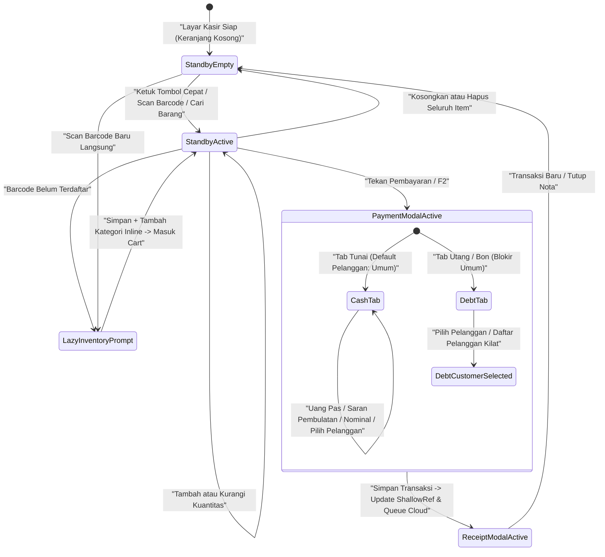

# Sitemap & Arsitektur Alur Interaksi (UI Flow): Kasiry (Habiba Store)

Dokumen ini mendefinisikan struktur tampilan responsif dual-mode (*Mobile Thumb-Zone* dan *Tablet/Desktop Bento Workstation*), diagram status transaksi (*State Machine*), pemetaan komponen aktif (`src/components/`), serta alur interaksi utama dari hulu ke hilir.

---

## 1. Konsep Tata Letak "Single-Screen POS Hub" Adaptif

Kasiry beroperasi dalam **satu layar utama tanpa perpindahan halaman/URL**. Tata letaknya menyesuaikan ukuran layar perangkat kasir secara otomatis:

### 1A. Tampilan Mobile (`< 768px` — Ergonomi Terbalik / Thumb Zone)
Tanpa footer aplikasi di bagian bawah agar konsol jari kasir leluasa, serta soft-keyboard input barang tetap terkunci (`inputMode="none"`) sampai input benar-benar disentuh.

```text
+-------------------------------------------------------------------------------+
|  TOP BAR:  [=] Menu Drawer  |  Kasiry / Habiba Store  |  Online/Cloud Status  |
+-------------------------------------------------------------------------------+
|  1. GLANCE ZONE: STRUK BELANJAAN (CartSection — Scrollable di Atas)           |
|  [Struk Belanjaan]  2 jenis • 3 pcs                              [Kosongkan]  |
|  - Gas LPG 3 Kg               Rp 22.000    [-] [ 1 ] [+]      Rp 22.000 (Hapus)|
|  - Indomie Goreng Spesial     Rp  3.500    [-] [ 2 ] [+]      Rp  7.000 (Hapus)|
+-------------------------------------------------------------------------------+
|  2. QUICK TAP ZONE: BARANG SERING TERJUAL / LIHAT SEMUA (FrequentProducts)    |
|  +-------------------------+  +-------------------------+                     |
|  | Gas LPG 3 Kg            |  | Galon Aqua 19L          |                     |
|  | Rp 22.000           [+] |  | Rp 20.000           [+] |                     |
|  +-------------------------+  +-------------------------+                     |
+-------------------------------------------------------------------------------+
|  3. FLOATING STICKY BOTTOM CONSOLE (Melayang di Jangkauan Jempol Bawah HP)    |
|  A. BarcodeInputBar (variant="floating", upward dropdown + Tombol Kamera)      |
|     [ Cari nama barang atau scan barcode...          ] [ Kamera ]             |
|  B. StickyBottomBar (Hanya muncul saat Cart > 0)                              |
|     Total Tagihan (3 pcs): Rp 29.000                   [ Pembayaran -> ]      |
+-------------------------------------------------------------------------------+
```

### 1B. Tampilan Tablet & Desktop (`md+` / `lg+` — Bento POS Workstation)
Memisahkan kolom struk checkout dan panel katalog + pencarian inline secara berdampingan (*locked viewport height*), dilengkapi filter kategori pill serta pintasan keyboard `/` (fokus cari) dan `F2` (buka modal Pembayaran).

```text
+-------------------------------------------------------------------------------------------+
| TOP BAR: Command Dock (`Chip Shift` | `Stok & Data ▾`, `Buku Utang`, `Kas Keluar`, `Laporan`, `⚙️ Setelan`)   |
+-----------------------------------+-------------------------------------------------------+
| KOLOM KIRI (5/12 md, 4/12 lg)     | KOLOM KANAN (7/12 md, 8/12 lg)                        |
| CartSection.vue                   | FrequentProductsSection.vue                           |
| - Header Struk & Kosongkan        | - Slot #search: BarcodeInputBar (inline, autofocus)   |
| - Daftar Belanjaan Scrollable     | - Pill Tabs: Terlaris | Semua (N) | Kategori Aktif    |
| - Ringkasan Total & Tombol        | - Grid Adaptif (Container Query 3 -> 4 -> 5 kolom)    |
|   [ Pembayaran (F2) ]             |   + card offscreen optimization (idx >= 16)           |
+-----------------------------------+-------------------------------------------------------+
| FOOTER DESKTOP (Khusus >= 1024px): Kasiry | Pintasan: [/] Cari • [F2] Bayar | Privacy/Terms|
+-------------------------------------------------------------------------------------------+
```

---

## 2. Diagram Status Transaksi (Transaction State Machine)



---

## 3. Hirarki Komponen Vue 3 Aktif (`src/components/`)

```text
App.vue (Orchestrator Kasa, Prewarm Checkout Chunks, Auto-Prompt Shift & Cloud Sync)
├── TopBar.vue (Desktop: Chip Shift + `Stok & Data ▾`, `Buku Utang`, `Kas Keluar`, `Laporan`, `⚙️`; HP: Chip Shift + Drawer 3 seksi)
│
├── Workspace Kasa Utama (Eager Load — Tampil Instan di Frame Pertama):
│   ├── CartSection.vue (Struk belanjaan, saklar Ecer/Grosir/Agen, inline editor harga manual, stepper qty, bayar)
│   ├── FrequentProductsSection.vue (Grid tombol cepat + tab kategori & slot pencarian desktop)
│   ├── BarcodeInputBar.vue (Floating di mobile dengan touch keyboard lock; Inline autofocus di desktop)
│   └── StickyBottomBar.vue (Bar total & tombol Pembayaran khusus mobile saat cart > 0)
│
└── 12 Modal Dialog (Lazy Loaded via defineAsyncComponent + watcher { immediate: true }):
    ├── PaymentModal.vue (Prewarmed: Tunai, QRIS uang pas, & Utang/Bon + dropdown loyalitas O(N))
    ├── LazyInventoryModal.vue (Prewarmed: Input kilat barcode baru + tambah kategori inline)
    ├── ReceiptModal.vue (Prewarmed: Pratinjau struk thermal 58mm + Cetak terisolasi + Kirim WA)
    ├── CameraScannerModal.vue (Lazy + vendor-zxing: Hybrid BarcodeDetector & ZXing + Switch Kamera/Flash/Zoom)
    ├── ProductManagementModal.vue (Kelola Barang CRUD + Stok Lunak Opsional + Manajemen Kategori Dinamis)
    ├── RestockModal.vue (Catat Nota Kulakan Multi-Item, 3 Sumber Dana, Deteksi Modal Naik, & Riwayat Rollback)
    ├── CustomerManagementModal.vue (Daftar Pelanggan loyalitas O(N), Profil & Riwayat penuh per ID via Dexie)
    ├── DebtBookModal.vue (Buku Utang Digital, Pelunasan Tunai/QRIS presisi kembalian, Pengingat WA, Riwayat Bon)
    ├── ExpenseModal.vue (Catatan Kas Keluar: Kategori cepat, Dari Laci vs Non-Tunai, KPI sisa laci & hapus 2-tap)
    ├── ShiftModal.vue (Buka Shift dg auto-modal awal & adopsi catatan hari ini, Tutup Buku + hitung selisih laci, Share WA)
    ├── DailyReportModal.vue (Ringkasan Shift Aktif/Harian, Kas Keluar, Riwayat Transaksi, Riwayat Shift, WA & Excel 7-sheet via vendor-xlsx)
    └── SettingsModal.vue (Profil Toko + Versi App, Google Drive/Sheets Sync, Backup JSON + Preview, Arsip Tahunan)
```

---

## 4. Alur Interaksi Detil (Step-by-Step User Flow)

### Alur A: Kasir Melayani Pembelian Cepat
1. Kasir mengetuk kartu barang pada **Barang Sering Terjual** (atau menembak barcode dengan scanner fisik / **Kamera**).
2. Di Mobile, mengetuk tombol cepat tidak memicu keyboard HP muncul ke layar; keyboard hanya muncul jika pengguna langsung mengetuk kotak pencarian. Di Desktop, kursor tetap siap di `BarcodeInputBar` dan tombol `/` langsung mengarahkan fokus ke pencarian.
3. Item langsung masuk ke **CartSection**; di Mobile, `StickyBottomBar` meluncur muncul di bawah.
4. Kasir menekan **[ Pembayaran ]** (atau tombol `F2` di Desktop), memilih nominal cepat / uang pas, lalu menekan **Selesaikan Pembayaran**.
5. Struk `ReceiptModal` tampil (siap **Cetak** thermal 58mm atau **Kirim WA**), transaksi tersimpan instan di IndexedDB & tercatat di `shallowRef` aktif tanpa *full table reload*, serta masuk ke antrean sinkronisasi Google Sheets & Drive.

### Alur B: Menangani Barang Belum Terdaftar (*Lazy Inventory*)
1. Barcode baru yang discan atau diketik + Enter belum ditemukan di database lokal.
2. `LazyInventoryModal` terbuka dengan nomor barcode terisi otomatis.
3. Kasir mengisi Nama Barang, Harga Jual (modal disarankan 80%), memilih kategori atau mengetuk tambah kategori secara inline, lalu menyimpan.
4. Barang langsung tersimpan ke tabel `products` IndexedDB dan masuk ke keranjang belanja saat itu juga.

### Alur C: Transaksi Utang / Bon Pelanggan & Pelunasan
1. Pada modal Pembayaran, kasir berpindah ke tab **"Utang / Bon"**.
2. Akun sistem **"Umum"** diblokir dari pencatatan utang; kasir memilih pelanggan yang sudah ada (misal `"Bu Tejo"`) atau mengetik nama baru.
3. Total belanja otomatis terakumulasi ke `customers.totalDebt` dan tercatat di **Buku Utang Digital** (`DebtBookModal`).
4. Saat melunasi di Buku Utang dengan uang pecahan lebih besar, sistem menampilkan nominal kembalian dan mencatat pelunasan ke kas hanya sebesar sisa utang yang terbayar (`appliedAmount = Math.min(amount, totalDebt)`).

### Alur D: Menjaga Performa Multi-Tahun & Arsip Tahunan
1. Setelah aplikasi berjalan berbulan-bulan hingga ribuan transaksi, layar Kasa harian hanya menyimpan jendela aktif **90 hari terakhir** di memori Vue agar tetap cepat, sementara ekspor Excel dan rincian riwayat 1 pelanggan otomatis melakukan query terindeks langsung ke IndexedDB.
2. Di **Pengaturan -> Cadangan & Google -> Kesehatan & Arsip Data Tahunan**, pemilik warung dapat memilih retensi (`> 3 Bulan`, `> 6 Bulan`, `> 1 Tahun`), mengunduh file arsip JSON (+ menyimpan salinan ke Google Drive bila terhubung), dan memangkas riwayat lama secara aman tanpa menyentuh daftar barang maupun `totalDebt` pelanggan.
