# Sitemap & Arsitektur Alur Interaksi (UI Flow): Kasiry (Habiba Store)

Dokumen ini mendefinisikan struktur tampilan, tata letak antarmuka terbalik (*Inverted Ergonomic Layout*), diagram status transaksi (*State Machine*), dan alur interaksi pengguna (*User Flow*) dari hulu ke hilir.

---

## 1. Konsep Tata Letak "Zero-Page Navigation" & Ergonomi Terbalik

Kasiry menggunakan pendekatan **Satu Layar Utama (Single-Screen POS Hub)** tanpa perpindahan routing halaman yang memusingkan kasir. 

Tata letak memisahkan antara **Area Pandang (Glance Zone)** di bagian atas dan **Area Aksi Jempol (Thumb Zone)** di bagian bawah yang melayang (*sticky*):

```text
+-------------------------------------------------------------------------------+
|  TOP BAR:  [=] Menu Drawer  |  Habiba Store - Minggu, 22 Nov  |  [HS] Online  |
+-------------------------------------------------------------------------------+
|  1. GLANCE ZONE: STRUK BELANJAAN (Di Paling Atas, Scrollable Max-H 35vh)      |
|  [🛍️ Struk Belanjaan]  2 jenis • 3 pcs                         [Kosongkan]    |
|  - Gas LPG 3 Kg               Rp 22.000    [-] [ 1 ] [+]       Rp 22.000 (🗑️)  |
|  - Indomie Goreng Spesial     Rp  3.500    [-] [ 2 ] [+]       Rp  7.000 (🗑️)  |
+-------------------------------------------------------------------------------+
|  2. QUICK TAP ZONE: BARANG SERING TERJUAL (Grid Tombol Cepat)                 |
|  +---------------------+  +---------------------+  +------------------------+ |
|  | Gas LPG 3 Kg        |  | Galon Aqua 19L      |  | Telur Ayam 1 Kg        | |
|  | Rp 22.000       [+] |  | Rp 20.000       [+] |  | Rp 28.000          [+] | |
|  +---------------------+  +---------------------+  +------------------------+ |
|  | Indomie Goreng      |  | Minyakita 1L        |  | Beras Ramos 5 Kg       | |
|  | Rp 3.500        [+] |  | Rp 16.000       [+] |  | Rp 68.000          [+] | |
|  +---------------------+  +---------------------+  +------------------------+ |
+-------------------------------------------------------------------------------+
|  3. FLOATING STICKY BOTTOM CONSOLE (Melayang di Jangkauan Jempol Bawah)        |
|  ===========================================================================  |
|  A. FORM INPUT BARCODE & CARI (Autofocus, Ring Glow, Upward Dropdown)         |
|     [ 🔍 Cari nama barang atau scan barcode...        ] [📷 Scan Kamera]      |
|                                                                               |
|  B. BAR TOTAL TAGIHAN & PEMBAYARAN (Kondisional: Muncul Hanya Saat Cart > 0)  |
|     Total Tagihan (3 Pcs): Rp 29.000                [ PEMBAYARAN ➜ ]          |
+-------------------------------------------------------------------------------+
```

---

## 2. Diagram Status Transaksi (Transaction State Machine)

```mermaid
stateDiagram-v2
    [*] --> StandbyEmpty: Layar Kasir Siap (Keranjang Kosong)
    
    StandbyEmpty --> StandbyActive: Ketuk Barang Cepat / Tembak Barcode
    note right of StandbyActive
        Bar Total Tagihan & Pembayaran
        otomatis meluncur muncul (slide-up)
    end note
    
    StandbyActive --> StandbyActive: Tambah / Kurangi Kuantitas
    StandbyActive --> StandbyEmpty: Tekan [Kosongkan] / Hapus Seluruh Item
    
    StandbyActive --> LazyInventoryPrompt: Barcode Baru Tidak Terdaftar
    LazyInventoryPrompt --> StandbyActive: Simpan Data Kilat (Item Masuk Keranjang)
    
    StandbyActive --> PaymentModalActive: Tekan [PEMBAYARAN]
    
    state PaymentModalActive {
        [*] --> CashTab: Default Tab Tunai
        CashTab --> CashTab: Pilih Uang Pas / Saran Pecahan / Ketik Manual
        CashTab --> ChangeCalculated: Uang Diterima >= Total
        
        [*] --> DebtTab: Tab Buku Utang / Bon
        DebtTab --> DebtCustomerSelected: Cari Nama / Ketik Pelanggan Baru
    }
    
    PaymentModalActive --> ReceiptModalActive: Transaksi Disimpan
    ReceiptModalActive --> StandbyEmpty: Transaksi Baru Selesai (Reset Struk)
```



---

## 3. Hirarki Komponen Vue 3 (`src/components/`)

```text
App.vue (State Manager & Main View Orchestrator)
├── TopBar.vue (Header Habiba Store, Tanggal, Avatar Status, Slide-over Drawer)
│   └── NavigationDrawer (Buku Utang, Laporan, Kelola Barang, Pengaturan)
│
├── Main Viewport:
│   ├── CartSection.vue (Struk belanjaan di atas, stepper qty, subtotal, tombol kosongkan)
│   └── FrequentProductsSection.vue (6-8 kartu tombol cepat barang sering terjual)
│
├── Floating Sticky Bottom Console:
│   ├── BarcodeInputBar.vue (Input autofocus, ring halo, enter key listener, upward dropdown)
│   └── StickyBottomBar.vue (Total tagihan, hitungan pcs, tombol [Pembayaran], conditional transition)
│
└── Modals & Overlays (Semua Mengadopsi Standar Desain Glassmorphism Modern):
    ├── ProductManagementModal.vue (Kelola Barang: Tambah, Edit, Hapus, Master Data)
    ├── PaymentModal.vue (Pembayaran: Tunai cerdas dengan hitungan kembalian vs Utang/Bon)
    ├── LazyInventoryModal.vue (Input kilat saat barcode baru discan di tengah transaksi)
    ├── DebtBookModal.vue (Buku Utang Digital, histori transaksi, pelunasan, 1-klik WA reminder)
    ├── DailyReportModal.vue (Laporan harian kasir: Omzet, untung, 1-klik WA teks & ekspor Excel)
    ├── SettingsModal.vue (Profil warung, integrasi Google GIS & Sheets, backup JSON, lisensi)
    ├── ReceiptModal.vue (Nota struk monospace 58mm/80mm siap cetak)
    └── CameraScannerModal.vue (Jendela scanner barcode kamera peramban)
```

---

## 4. Alur Interaksi Detil (Step-by-Step User Flow)

### Alur A: Kasir Melayani Pembelian Cepat (< 5 Detik)
1. Pembeli mengambil 1 Gas LPG 3 Kg dan 2 Indomie Goreng.
2. Kasir mengetuk kartu **Gas LPG 3 Kg** di bagian *Barang Sering Terjual*.
   - Seketika item masuk ke **Struk Belanjaan** di atas.
   - Bar **Total Tagihan & Pembayaran** di bawah meluncur muncul dengan animasi halus.
3. Kasir menembak barcode Indomie dua kali dengan barcode scanner fisik (atau scan via kamera).
   - Tembakan scanner otomatis mengalir ke input bar yang telah berstatus **Autofocus**.
   - Indomie langsung bertambah 2 pcs di struk atas.
4. Total tagihan terhitung otomatis: **Rp 29.000 (3 Pcs)**.
5. Kasir menekan tombol **[ Pembayaran ➜ ]** di jangkauan jempol bawah.
6. Kasir memilih pecahan uang yang diberikan (misal Rp 50.000), sistem menampilkan kembalian **Rp 21.000**.
7. Kasir menekan **Simpan Transaksi**. Struk muncul, keranjang kembali kosong, dan kasir siap melayani pembeli berikutnya.

---

### Alur B: Menangani Barang Belum Terdaftar (Lazy Inventory)
1. Pembeli membawa produk baru yang belum pernah diinput ke sistem.
2. Scanner menembak barcode produk.
3. Karena barcode belum ada di database lokal:
   - Sistem tidak membatalkan transaksi.
   - Pop-up **Input Kilat Barang Baru** langsung muncul seketika dengan nomor barcode terisi otomatis.
4. Kasir cukup mengetik nama barang dan harga jual, lalu tekan **Simpan**.
5. Barang langsung tersimpan permanen di database dan otomatis masuk ke keranjang belanja saat itu juga.

---

### Alur C: Transaksi Utang / Bon Tetangga
1. Pembeli meminta belanjaannya dicatat di buku utang.
2. Di modal Pembayaran, kasir memilih tab **"Utang / Bon"**.
3. Kasir mengetik nama pelanggan (misal: "Bu Tejo").
4. Saldo utang lama pelanggan ditampilkan. Total belanjaan baru otomatis diakumulasikan ke saldo utang.
5. Transaksi selesai tanpa uang tunai dan tercatat di **Buku Utang Digital**.
