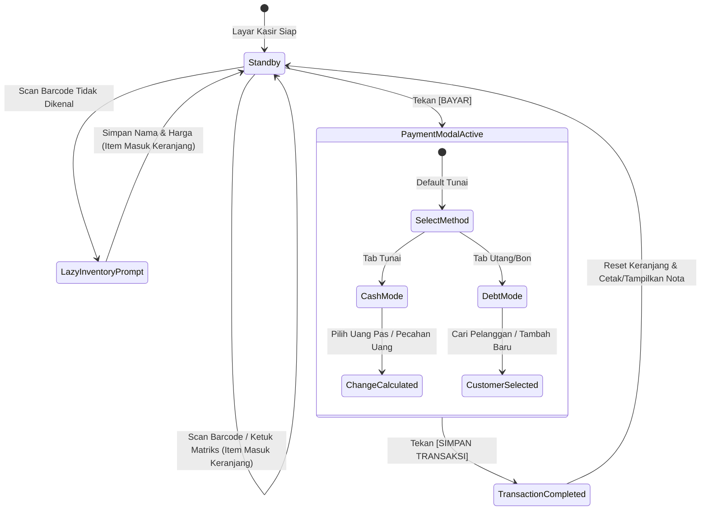

# Sitemap & Arsitektur Alur Interaksi (UI Flow): Kasiry

Dokumen ini mendefinisikan struktur tampilan, hirarki komponen, diagram status transaksi (*State Diagram*), dan alur interaksi pengguna (*User Flow*) dari hulu ke hilir.

---

## 1. Konsep Tata Letak "Zero-Page Navigation"

Kasiry tidak memiliki sistem *routing* halaman yang berpindah-pindah (`/checkout`, `/inventory`, `/report`) yang membingungkan kasir. Seluruh interaksi kasir terjadi di **Satu Layar Sentral (POS Hub)**, sementara fitur sekunder diakses via **Top Layer Dialog Modal**.

```text
+-----------------------------------------------------------------------+
|  TOP BAR: [Logo Kasiry]  Warung Bu Tejo  |  [Status Online]  [Sync]   |
|  Tombol Cepat: [📋 Buku Utang]  [📊 Laporan]  [⚙️ Pengaturan/Google]   |
+-----------------------------------------------------------------------+
|  SMART BARCODE & INPUT BAR                                            |
|  [ 🔍 Ketik nama barang atau tembak barcode...     ] [📷 Kamera Scan]  |
+-----------------------------------------------------------------------+
|  MATRIKS TOMBOL CEPAT DINAMIS (Barang Curah & Terlaris)                |
|  +--------------+  +--------------+  +--------------+  +------------+ |
|  |   LPG 3 KG   |  |  TELUR 1 KG  |  |   ES BATU    |  | MINYAKITA  | |
|  |  Rp 22.000   |  |  Rp 28.000   |  |   Rp 2.000   |  | Rp 16.000  | |
|  +--------------+  +--------------+  +--------------+  +------------+ |
+-----------------------------------------------------------------------+
|  KERANJANG BELANJA AKTIF (Auto-scroll & Sticky Summary)               |
|                                                                       |
|  1. Indomie Goreng Spesial                  Rp 3.500                  |
|     [-]  [ 2 ]  [+]                                  Subtotal Rp 7.000|
|                                                                       |
|  2. Le Minerale 600ml                       Rp 3.500                  |
|     [-]  [ 1 ]  [+]                                  Subtotal Rp 3.500|
+-----------------------------------------------------------------------+
|  STICKY CHECKOUT BAR (Bottom Bar Raksasa)                             |
|  Total: Rp 10.500  (2 Jenis Barang)                                   |
|  [                  >>> BAYAR SEKARANG <<<                          ] |
+-----------------------------------------------------------------------+
```

---

## 2. Diagram Status Transaksi (Transaction State Machine)



---

## 3. Hirarki Komponen Vue 3 (`src/components/`)

```text
App.vue
├── TopBar.vue
│   ├── StoreInfo.vue
│   ├── OnlineStatusBadge.vue
│   └── TopActions.vue (Buku Utang, Laporan, Pengaturan)
│
├── MainPOS.vue
│   ├── BarcodeInputBar.vue (Input auto-focus, HID detector, Camera trigger)
│   ├── CameraScannerModal.vue (BarcodeDetector API / ZXing)
│   ├── MacroProductMatrix.vue (Tombol cepat barang curah non-barcode)
│   ├── CartSection.vue (List belanja, kuantitas +/- besar, subtotal)
│   └── StickyTotalBar.vue (Total nominal tebal + Tombol [BAYAR])
│
└── Modals / Overlays:
    ├── LazyInventoryModal.vue (Pop-up cepat saat barcode baru discan)
    ├── PaymentModal.vue
    │   ├── CashPaymentSection.vue (Uang Pas, Pecahan 2rb-100rb, Kembalian)
    │   └── DebtPaymentSection.vue (Lazy customer name search & create)
    ├── DebtBookModal.vue (Tabel utang, cicil/lunas, share WhatsApp)
    ├── DailyReportModal.vue (Ringkasan hari ini, kirim WA, download Excel)
    ├── SettingsModal.vue (Profil warung, GIS Google Login, Backup JSON)
    └── ReceiptModal.vue (Struk belanja digital & opsi cetak)
```

---

## 4. Alur Interaksi Detil (Step-by-Step User Flow)

### Alur A: Kasir Melayani Belanja Standar (Waktu Target: < 10 Detik)
1. Pembeli meletakkan 1 Indomie Goreng dan 1 Tabung Gas LPG 3Kg di meja.
2. Kasir menembakkan scanner fisik ke barcode Indomie $\rightarrow$ Barang otomatis masuk keranjang (Qty: 1, Rp 3.500).
3. Kasir mengetuk tombol makro **[ LPG 3 KG ]** di layar $\rightarrow$ LPG masuk keranjang (Qty: 1, Rp 22.000). Total: **Rp 25.500**.
4. Kasir mengetuk tombol hijau raksasa **[ BAYAR ]**.
5. Modal Pembayaran Tunai muncul:
   * Tombol dinamis menampilkan: `[UANG PAS Rp 25.500]`, `[Rp 30.000]`, `[Rp 50.000]`, `[Rp 100.000]`.
   * Pembeli memberikan uang Rp 50.000 lembaran.
   * Kasir mengetuk tombol `[Rp 50.000]`.
   * Angka **KEMBALIAN: Rp 24.500** langsung muncul dalam ukuran font raksasa hijau.
6. Kasir mengetuk **[ SELESAI ]** $\rightarrow$ Keranjang kembali bersih, siap melayani antrean berikutnya.

### Alur B: Input Sambil Jalan (Lazy Inventory Barcode Baru)
1. Pembeli membawa biskuit kaleng varian baru yang belum pernah dijual di warung.
2. Kasir menembakkan barcode $\rightarrow$ Sistem memeriksa `KasiryDB.products`.
3. Karena belum ada di database, modal **Lazy Inventory** otomatis meluncur ke tengah layar.
4. Kolom `Nama Barang` langsung fokus. Kasir mengetik: *"Biskuit Regal 250g"*.
5. Kasir mengisi kolom `Harga Jual`: *"18000"*.
6. Kasir menekan `Enter` atau mengetuk **[ Simpan & Jual ]**.
7. Biskuit langsung masuk keranjang transaksi, sekaligus tersimpan permanen di katalog toko.

### Alur C: Belanja Bon / Utang (Lazy Customer)
1. Pembeli berkata: *"Bu, berasnya 5 kg utang dulu ya, nanti sore bapaknya gajian."*
2. Kasir memasukkan beras 5 kg ke keranjang, lalu menekan **[ BAYAR ]**.
3. Di modal pembayaran, kasir berpindah ke tab **[ UTANG / BON ]**.
4. Kolom nama pelanggan muncul. Kasir mengetik: *"Bu Tejo"*.
5. Matriks otomatis menyaring:
   * Jika nama "Bu Tejo" sudah ada $\rightarrow$ Kasir tinggal ketuk tombol namanya.
   * Jika belum ada $\rightarrow$ Muncul tombol satu-klik: **[ + Tambah Pelanggan "Bu Tejo" ]**.
6. Kasir menekan **[ CATAT UTANG ]**.
7. Transaksi selesai. Buku Utang Bu Tejo otomatis bertambah saldo tagihannya.
